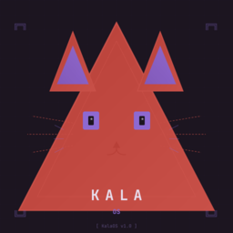

# KalaOS 🐱

> **Arch-based. Cat-powered. Game-ready.**

KalaOS es una distribución Linux gaming optimizada basada en **CachyOS kernel** con **Hyprland**, **Ghostty**, y una estética **pixel-art cat-arch** con paleta morado/rojo personalizable.



## ✨ Características

| Área | Detalles |
|------|----------|
| **Kernel** | CachyOS BORE/EEVDF scheduler, x86-64-v3/v4, LTO, PGO |
| **Desktop** | Hyprland (animaciones, blur, gaps, keybindings Omarchy-style) |
| **Terminal** | Ghostty con syntax highlighting IDE-like, Fish + Starship + Atuin |
| **Bar/Launcher** | Waybar + Rofi/Wofi + SwayNC (tema dinámico desde wallpaper) |
| **Gaming** | Gamescope session, Proton-GE, Wine-GE, MangoHud, vkBasalt, Gamemode |
| **Drivers** | NVIDIA (open/propietario auto), AMD, Intel, Vulkan layers |
| **Login** | Greetd + tuigreet (TUI, tema KalaOS) |
| **Fonts** | macOS SF Pro + JetBrains Mono Nerd + Pixel font custom |
| **Theming** | Paleta morado/rojo base, auto-colores desde wallpaper (matugen) |
| **CLI** | `kala` - gestor propio (install, update, theme, wallpaper, gaming, kernel, doctor...) |
| **Performance** | ZRAM zstd, CPU governor performance, irqbalance, tuned, sysctl gaming |

## 🚀 Instalación Rápida

```bash
# 1. Instala Arch Linux o CachyOS minimal (base + linux-firmware + sudo + networkmanager)
# 2. Clona y ejecuta
git clone https://github.com/tu-usuario/kalaos.git
cd kalaos
sudo ./install.sh
```

> **Nota**: Requiere sistema base Arch/CachyOS ya instalado con particiones montadas.

## ⚙️ Configuración

Edita `kalaos.conf` antes de instalar o después y re-ejecuta `./install.sh`:

```bash
# Ejemplos
KERNEL_VARIANT="cachyos-bore"      # cachyos-eevdf, linux-zen
GPU_VENDOR="auto"                  # nvidia, amd, intel, hybrid
NVIDIA_DRIVER="auto"               # nvidia-open-dkms (RTX 20+), nvidia-dkms (GTX 10-)
ENABLE_GAMING=true
THEME_BASE="purple-red"            # purple-red, cyan, amber, custom
DEBLOAT_LEVEL="aggressive"         # minimal, standard, aggressive
AUTOLOGIN_USER="tu-usuario"        # Para autologin
```

## 🎮 Uso Diario

```bash
# Health check completo
kala doctor

# Cambiar wallpaper + tema completo
kala wallpaper ~/Pictures/mi-foto.jpg

# Cambiar tema base
kala theme cyan

# Toggle gaming stack
kala gaming off

# Cambiar kernel
kala kernel cachyos-eevdf

# Actualizar sistema + configs
kala update

# Backup configs
kala backup
```

## 🎨 Theming Dinámico

El sistema extrae colores de tu wallpaper y regenera **todos** los temas:

- Hyprland (bordes, gaps, blur)
- Waybar (CSS)
- Ghostty (terminal + syntax highlighting)
- Rofi/Wofi (launchers)
- GTK3/GTK4 (apps)
- Starship (prompt)
- Tuigreet (login)

```bash
kala wallpaper ~/Pictures/gaming.jpg  # ¡Todo se recolorea!
```

## 📁 Estructura del Repo

```
kalaos/
├── install.sh              # Instalador idempotente
├── kalaos.conf             # Config declarativa (source of truth)
├── modules/                # 14 módulos (00-base → 13-branding)
├── dotfiles/               # Configs versionados (stow/chezmoi)
│   ├── hypr/               # Hyprland config
│   ├── ghostty/            # Terminal config
│   ├── waybar/             # Bar config
│   ├── rofi/ wofi/         # Launchers
│   ├── fish/               # Shell config
│   ├── starship/           # Prompt
│   ├── greetd/             # Login
│   └── kala/               # CLI subcomandos
├── assets/                 # Logo, wallpapers, bootsplash, plymouth
├── pkglists/               # Listas paquetes (core, gaming, fonts, debloat)
├── tests/                  # Smoke tests
└── docs/                   # INSTALL, CONFIG, CUSTOMIZE, BRANDING
```

## 🔧 Módulos de Instalación

| Módulo | Descripción |
|--------|-------------|
| `00-base` | Repos, pacman.conf, base packages, services |
| `01-kernel` | CachyOS kernel (BORE/EEVDF), cmdline, initramfs |
| `02-drivers` | GPU drivers (NVIDIA/AMD/Intel), Vulkan layers |
| `03-gaming` | Steam, Proton-GE, gamescope, MangoHud, gamemode |
| `04-hyprland` | Hyprland + keybindings Omarchy-style |
| `05-shell` | Ghostty, Fish, Starship, Atuin, Zoxide, Carapace |
| `06-bar` | Waybar, Rofi, Wofi, SwayNC |
| `07-theming` | Matugen/Wallust, paleta morado/rojo, auto-colores |
| `08-fonts` | SF Pro, JetBrains Mono Nerd, KalaPixel |
| `09-login` | Greetd + tuigreet TUI themed |
| `10-cli` | CLI `kala` completa |
| `11-debloat` | Limpieza apps/locales/docs/man (3 niveles) |
| `12-perf` | ZRAM, governor, irqbalance, sysctl, tuned, fstrim |
| `13-branding` | Logo cat-arch, bootsplash, plymouth, fastfetch |

## 📚 Documentación

- [INSTALL.md](docs/INSTALL.md) - Guía de instalación completa
- [CONFIG.md](docs/CONFIG.md) - Referencia completa kalaos.conf
- [CUSTOMIZE.md](docs/CUSTOMIZE.md) - Personalización avanzada
- [BRANDING.md](docs/BRANDING.md) - Guía de branding y logo

## 🐛 Troubleshooting

```bash
# Verificar estado
kala doctor

# Regenerar tema
${KALAOS_REPO:-$HOME/kalaos}/modules/generate-theme.sh

# Rebuild initramfs (NVIDIA)
sudo mkinitcpio -p kalaos

# Ver logs
journalctl -u greetd -f
```

## 🤝 Contribuir

1. Fork el repo
2. Crea branch: `git checkout -b feature/mi-feature`
3. Edita `kalaos.conf` o módulos/dotfiles
4. Test: `sudo ./install.sh --dry-run`
5. PR con descripción de cambios

## 📄 Licencia

- Código: MIT
- Branding/Logo: CC-BY-SA 4.0

---

**Hecho con 💜 y 🐱 para gamers que aman Arch.**